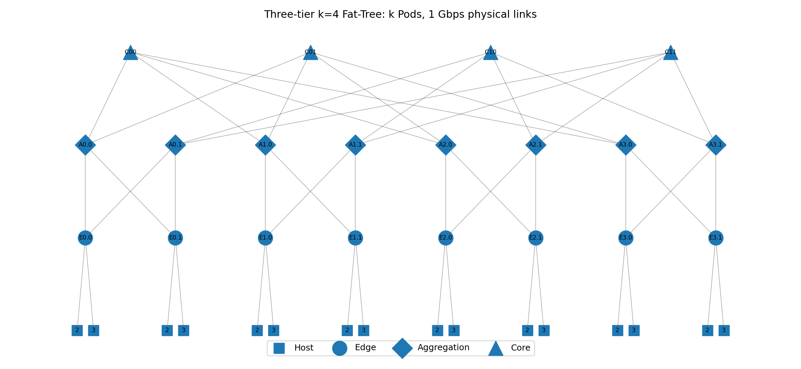
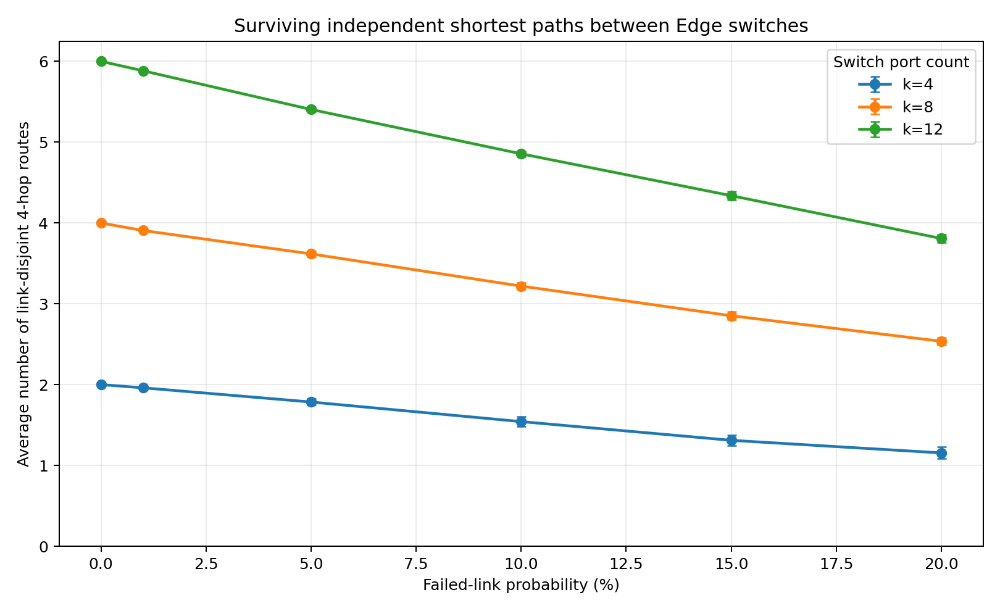
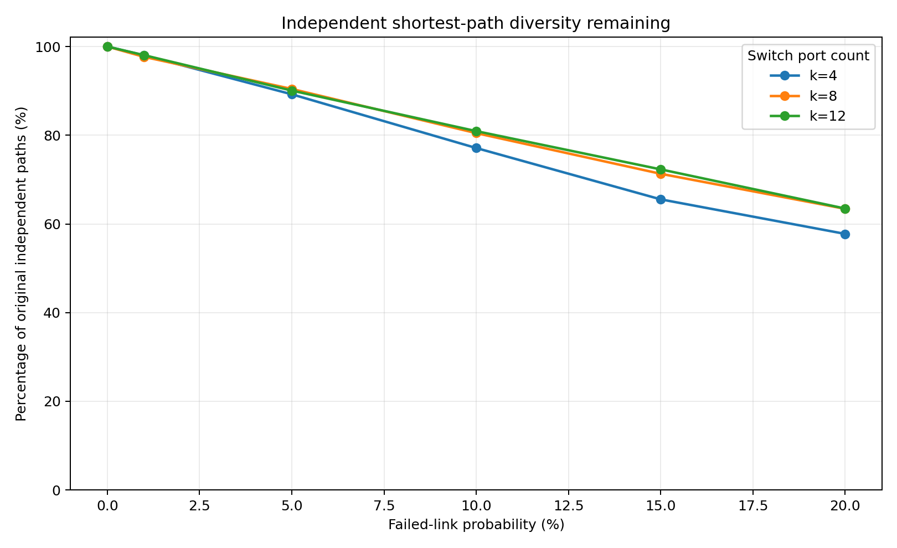
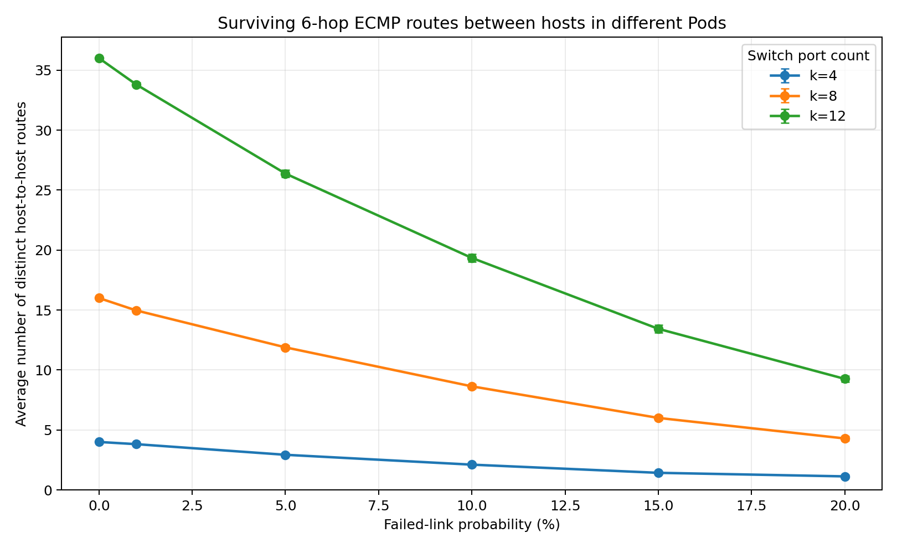

# Fat-Tree Path Diversity Under Link Failures


## Overview

This project generates a three-tier Fat-Tree topology and investigates:

**How does the probability of link failure affect the number of alternative paths, and how does the switch port count (`k`) change the result?**

The implementation uses Python, NetworkX, and Matplotlib. It models the network structure and link failures, **not** packet forwarding or measured throughput.

## Topology

The generator follows the Fat-Tree architecture in Al-Fares et al. (2008). Every switch has `k` ports; `k` is even. The network consists of Core, Aggregation, and Edge switches, with hosts attached to Edge switches.

| Property | Formula | `k=4` | `k=8` | `k=12` |
|---|---:|---:|---:|---:|
| Pods | `k` | 4 | 8 | 12 |
| Hosts | `k³/4` | 16 | 128 | 432 |
| Switches | `5k²/4` | 20 | 80 | 180 |
| Physical links | `3k³/4` | 48 | 384 | 1,296 |

Each link has a nominal capacity of 1 Gbps in the graph metadata. IP addresses encode the Pod, switch, and host location, following the paper.



*Example: a generated `k=4` Fat-Tree, containing 16 hosts and 20 switches.*

## Installation and Usage

Requires Python 3.10 or later.

```bash
pip install -r requirements.txt
```

Generate a network and optionally mark failed links:

```bash
python main.py generate --k 4 --failure-rate 10 --seed 2026 --plot
```

Run the full experiment and generate the CSV and plots:

```bash
python main.py experiment --k-values 4 8 12 --failure-rates 0 1 5 10 15 20 --trials 100 --pairs 64 --seed 2026
```

Run the tests:

```bash
python -m unittest discover -s tests -v
```

Main inputs are the switch port count `k`, failure percentage, number of trials, number of sampled host pairs, and random seed. The optional `--failure-mode exact` removes an exact rounded percentage of links; the default `independent` mode makes each link fail independently with the given probability.

## Experimental Method

We tested `k = 4, 8, 12` and failure probabilities of `0%, 1%, 5%, 10%, 15%, 20%`.

For each configuration, we simulated **100 random failure realizations** and measured the average over **64 sampled host pairs in different Pods**. A fixed seed (`2026`) makes the results reproducible.

We calculated two metrics:

1. **ECMP paths:** the number of surviving original six-link shortest routes between two hosts. Paths may share physical links. Without failures there are `(k/2)²` routes.
2. **Independent paths:** the maximum number of surviving, mutually link-disjoint original four-link shortest routes **between the two Edge switches** hosting those servers. Without failures there are `k/2` routes.

We use Edge-to-Edge endpoints for the second metric because each host has only one access link, which all its end-to-end routes share. For the independent metric, each Aggregation group contributes one route if at least one of its Core choices survives.

## Results

### 1. Surviving independent paths (absolute count)



**Example:** With `k=8`, the average drops from **4.000** independent Edge-to-Edge routes with no failures to **3.219** at 10% failure probability and **2.536** at 20%.

**Meaning:** Larger switches provide more independent route choices in absolute numbers, even after failures.

### 2. Independent paths remaining (percentage)



This is the first metric divided by the healthy baseline `k/2`, allowing a comparison across network sizes.

**Example:** At 20% failure probability, **57.8%**, **63.4%**, and **63.5%** of the original independent routes remain for `k=4`, `8`, and `12`, respectively.

**Meaning:** Increasing `k` improves the survival percentage somewhat, but the improvement from `k=8` to `k=12` is small.

### 3. Surviving ECMP paths between hosts



**Example:** With `k=8`, the number of original shortest host-to-host routes decreases from **16.000** to **8.637** at 10% failure probability and **4.292** at 20%.

**Meaning:** Each such route needs six working links, including both host access links. At 20% independent link-failure probability, the expected number of surviving routes is `16 × 0.8⁶ ≈ 4.19`, close to the simulation result.

| `k` | Failure probability | Avg. independent Edge paths | Avg. host ECMP paths |
|---:|---:|---:|---:|
| 4 | 0% / 20% | 2.000 / 1.155 | 4.000 / 1.130 |
| 8 | 0% / 20% | 4.000 / 2.536 | 16.000 / 4.292 |
| 12 | 0% / 20% | 6.000 / 3.808 | 36.000 / 9.260 |

The complete results, including intermediate failure rates, are available in [`results/summary.csv`](results/summary.csv).

## Conclusions and Limitations

Fat-Tree provides alternative paths that survive some physical link failures. Increasing `k` increases the **absolute number** of available paths. However, the proportion of paths that survive does not necessarily increase by the same factor.

The experiment counts **original shortest paths only**, not longer fallback routes. A missing shortest route does not necessarily mean the hosts are disconnected. Failures are assumed independent, and the project does not simulate throughput, congestion, delay, or the routing algorithms in the paper.

## AI Usage

**OpenAI ChatGPT was used to assist with implementing the Python code, generating the experimental graphs, and Layout this README.** 

## Reference

M. Al-Fares, A. Loukissas, and A. Vahdat, “A Scalable, Commodity Data Center Network Architecture,” *ACM SIGCOMM*, 2008. [DOI: 10.1145/1402946.1402967](https://doi.org/10.1145/1402946.1402967).
